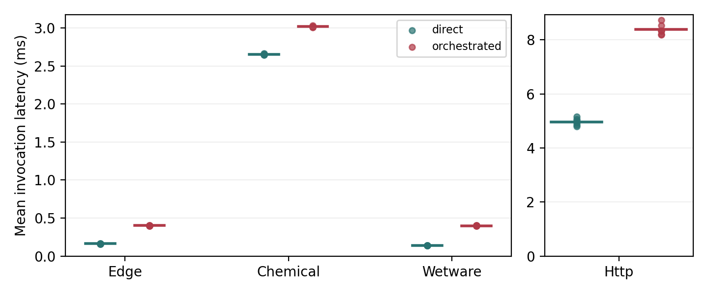
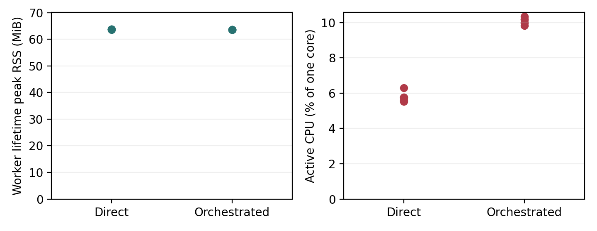
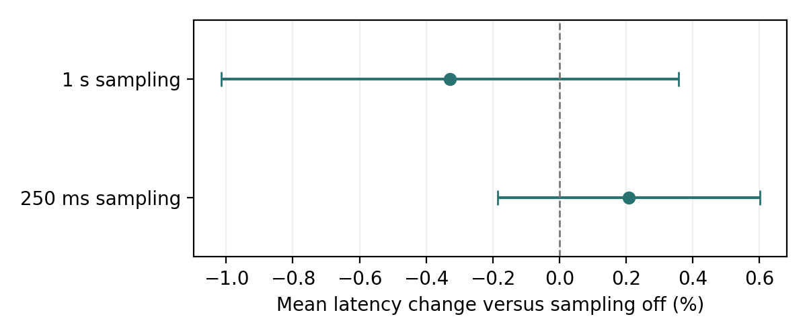

# CP2N2 on Embedded Linux: A Feasibility Study of the phys-MCP Baseline

**Workshop working draft - author list and venue pending approval**

Artifact release: October 19, 2026. This repository publication is not a workshop acceptance or a peer-reviewed publication.

## Abstract

This study evaluates the legacy phys-MCP baseline on Jetson Orin Nano, not the latest CP2N2 release.

Physical neural networks require software to reason about substrate capabilities, readiness, telemetry, and recovery rather than merely invoke an inference endpoint. CP2N2 provides such a control-plane architecture, but its deployability on an embedded host is a separate empirical question. We evaluate the existing phys-MCP reference implementation on a Jetson Orin Nano using isolated processes, measured wall-clock timing, process resource samples, and platform power telemetry. A fixed campaign contains 60 fresh-process trials: six paired direct/orchestrated comparisons for each of three local behavioral twins and a same-host HTTP backend, followed by six paced edge-resource pairs. Across {{latency_requests}} measured latency requests, {{latency_successes}} completed successfully. Mean additional local orchestration cost ranges from {{local_overhead_range}}; the edge path adds {{edge_overhead}}. The measured standard-profile worker reaches {{peak_rss_range}} MiB peak RSS in the resource trials. An earlier six-block sampler calibration estimates a +0.208% mean-latency change at 250 ms sampling, with a paired 95% interval spanning zero. These results support deployment feasibility for the tested embedded-Linux configuration, not smartwatch compatibility, physical-substrate performance, energy efficiency, or sustained availability. We release the manuscript source, raw traces, checksums, and a reproducible analysis/build pipeline.

## 1. Introduction

Physical neural networks (PNNs) use material dynamics as part of computation. Their interfaces and operational constraints differ: a concentration-driven substrate, a spike-oriented biological system, and a device-like vector backend need not share preparation, observation, calibration, or reset semantics. CP2N2 addresses this heterogeneity through a substrate-aware control plane and a separation between orchestration, twin state, and substrate execution [1]. That architecture motivates placing supervisory software near a physical process, but an architectural placement option does not establish a practical embedded resource budget.

This paper asks a narrower question: what does the current Python prototype cost when hosted on an embedded Linux computer? The distinction matters for proposed deployments at sensing and actuation boundaries. A watch or wearable can motivate the need for local supervision, intermittent connectivity, and explicit resource budgets, but it is not interchangeable with a Jetson development board. We therefore use wearables only as motivation. The tested host is a Jetson Orin Nano; the executed PNN representations remain software twins and a localhost service.

Our contribution is an empirical deployment and measurement study, not a new orchestration architecture. We contribute (1) an isolated measurement boundary that distinguishes orchestration from evaluation tooling and synthetic backend telemetry; (2) repeated, paired measurements across three local runtime regimes and a service boundary; and (3) a provenance-bound artifact that makes both results and claim limitations inspectable. The study is deliberately exploratory. It does not search for a favorable configuration or discard workload failures, and it does not claim to reproduce every mechanism discussed in the CP2N2 manuscript.

We address three questions. RQ1: What wall-clock cost does orchestration add to direct adapter use? RQ2: What process footprint and platform-power observations accompany a paced embedded workload? RQ3: How sensitive is the local edge timing measurement to the periodic samplers used by the harness?

## 2. System and Measurement Boundary

The canonical upstream is `fischesn/cp2n2` [4]. On October 19, 2026, its main branch resolved to `d43427e33447dce6bd4441e5b1d086dc6a84fc3a`, and its latest listed release was v5.1.1. Upstream distinguishes the v3.0 legacy baseline from subsequent resource-contract, lifecycle, lease, and adapter/runtime work. Our evaluated checkout has Git base {{evaluated_commit}} with hash-recorded local evaluation additions; its README identifies the phys-MCP v3.0 line. Consequently, all numerical claims here apply only to that measured snapshot. They do not establish the footprint or performance of upstream v5.1.1 or its additional enforcement mechanisms. A new-version evaluation must rerun the protocol against a separately pinned checkout.

We use the existing phys-MCP implementation of CP2N2 [1,3]. The orchestrator discovers descriptors, evaluates a task against backend capabilities and runtime state, prepares the selected adapter, invokes it, collects telemetry, validates postconditions, and may perform recovery. The measured source is identified by SHA-256 manifests in each campaign. We do not introduce a new scheduler, change adapter behavior, or optimize the control-plane implementation for these experiments.

The three local bindings are a chemical behavioral twin, a synthetic wetware twin, and a low-latency vector-oriented edge twin. A fourth path exposes the edge adapter through a separate HTTP service on the same host. These are operationally contrasting software paths, not measurements of chemical reactions, living tissue, photonic hardware, or memristive hardware. The real embedded component in this study is the orchestration host. The biological interface is neither stimulated nor contacted during the new campaign.

The direct baseline calls adapter preparation, invocation, and telemetry collection. The orchestrated path calls the complete `execute_task()` interface. Direct access is intentionally a lower-functionality cost baseline: it does not enforce the same checks, so its faster execution is not a substitute for orchestration. Both paths construct the same standard registry of three local adapters. HTTP adds its service adapter to that registry. Directed requests and disabled fallback keep each cost comparison on its intended backend.

Two timing distinctions prevent misleading attribution. First, native recovery inside `execute_task()` belongs to its measured wall-clock interval, whereas the benchmark's explicit between-request reset and recalibration are timed separately. Second, the edge twin's reported latency and energy proxy are synthetic values. We retain them as labeled telemetry but do not subtract them from measured round-trip time or use them as energy measurements. The HTTP result is an adapter/orchestrator comparison across a localhost software boundary, not a pure network-latency estimate.

## 3. Experimental Method

### 3.1 Platform and isolation

The host identifies as an NVIDIA Jetson Orin Nano Engineering Reference Developer Kit Super, running {{platform_release}} with Python {{python_version}}. The machine reports {{cpu_count}} online CPUs and approximately {{physical_ram_gib}} GiB of physical memory. The configured power mode is 25 W; this is a configuration setting, not observed power consumption. We do not change power mode, clock policy, cooling, or operating-system scheduling during the study. Cooling details, ambient temperature, and background desktop activity were not controlled, which limits attribution and cross-machine comparison.

Each trial starts a fresh Python worker. Plotting, demo helpers, and broad evaluation helpers are excluded from that worker. The existing adapter package nevertheless eagerly imports other adapters, so the measured footprint is the deployed prototype worker with its dependencies, not the isolated core alone or an import-pruned lower bound. Module inventories and package versions are archived. The resource controller records its own process separately from the worker and, where applicable, the HTTP service.

Numerical-library thread variables are set to one in workers and the Python hash seed is fixed. The HTTP service retains its existing startup behavior and inherited environment, which is recorded separately; its twin seed remains fixed at 19. Local twins use a different seed for each paired block, with the same seed within the direct/orchestrated pair. The fresh-process design does not imply a cold filesystem cache.

### 3.2 Repeated comparisons

The campaign configuration was generated and frozen before the new measurements. For each local backend we execute six direct/orchestrated pairs, each with 200 excluded warmup requests and 2,000 measured requests. For HTTP, each of six pairs uses 100 warmup and 300 measured requests. Direct-first and orchestrated-first order alternate across pairs. Every request uses the same declared task payload within a pair, and explicit reset/recalibration policies match. Such maintenance advances twin state; it does not rewind the random generator.

Latency trials disable periodic process and platform sampling, while retaining per-request logging and controller timeout checks. A second campaign segment contains six edge-resource pairs at 100 planned releases/s, with six-second active windows and three-second ready-worker idle windows before and after each active window. Sampling is enabled at 250 ms. Each trial retains the same process for warmup, idle, and active phases. These short windows characterize this request rate, not a thermal steady state or a one-hour service lifetime.

Pacing uses a monotonic release schedule with one active request and no catch-up bursts. Missed releases are counted. A duration deadline stops admission; an in-flight request can finish, with the controller timeout acting as the process-level bound. We retain failed invocations, maintenance errors, unexpected selections, and timeout records rather than replacing them with successful retries. Warmup is excluded from measured request counts.

### 3.3 Resources, power, and uncertainty

Linux process samples provide current/peak RSS and cumulative CPU time. Peak RSS is a lifetime high-water mark, not an allocation delta or a control-plane-only footprint. Phase-specific CPU utilization is the user-plus-system CPU-time difference divided by the observed sample span and normalized to one core. Summed RSS would double-count shared pages; we do not present it as total exclusive memory.

Platform power comes from timestamped `tegrastats` VDD_IN observations [2]. We integrate adjacent observations only over their intersection with each phase and report sampled time coverage. Active-minus-idle estimates subtract the mean of the two bracketing ready-worker idle means, requiring at least 90% coverage in all three windows. Negative estimates are preserved. This quantity includes backend execution, logging, monitoring, and uncontrolled system variation. It is not isolated control-plane power, and interpolation coverage alone does not establish sensor precision or justify battery-life extrapolation.

For latency, the independent analysis unit is a fresh-process paired block, not each individual request. We report means of per-trial means and paired differences with two-sided 95% Student t intervals over six block differences. These intervals assume independent blocks and an adequate approximation for their differences; temporal correlation, background activity, and the small block count remain limitations. Per-trial quantiles are retained in the artifact. We do not infer rare-event reliability from these samples.

## 4. Results

### 4.1 Local and service-path cost

All {{latency_successes}} of {{latency_requests}} measured requests in the latency segment succeeded, with {{latency_failed_trials}} failed trials. Table 1 summarizes the six pairs for each path. The difference is computed within each pair before aggregation; it is not obtained by subtracting unrelated historical averages.

{{latency_table}}

Table 1. Mean wall-clock invocation time and added orchestration cost. Confidence intervals are over paired trial differences. HTTP is same-host, not a remote-network measurement.

The local results demonstrate that the reference control path can execute on this embedded host with the measured absolute overhead. Relative multipliers must be interpreted cautiously because the direct twins are intentionally small. The HTTP difference includes all extra calls and control work exercised by orchestration; it cannot be attributed solely to network transport. These results do not establish physical PNN inference latency or hard real-time deadlines.

### 4.2 Resource envelope at a paced load

The resource segment completed {{resource_successes}} of {{resource_requests}} executed requests and recorded {{missed_releases}} missed planned releases. There were {{resource_failed_trials}} failed resource trials. Table 2 reports the observed standard-profile process footprint and CPU demand separately for direct and orchestrated execution. Both workers hold the same registry, so the direct row is not a minimal standalone backend deployment.

{{resource_table}}

Table 2. Resource segment at 100 planned releases/s. RSS ranges are across worker lifetime peaks; CPU means are across active-window samples, normalized to one core. Startup includes imports, registration, task serialization, and discovery.

{{power_result}}

The bracketing estimates are included to make the instrumentation explicit, not to claim an energy advantage. Short windows, host background activity, and sensor granularity can be comparable to the incremental workload. A defensible energy-efficiency claim would require longer paired windows, an agreed useful-work definition, controlled host conditions, and uncertainty analysis appropriate to the sensor. The configured 25 W mode must not be confused with measured consumption.

### 4.3 Sampler calibration

A preceding exploratory calibration executed six matched blocks of three fresh-process, three-second local-edge trials: sampling off, 250 ms sampling, and 1 s sampling. All six condition permutations were used once, with 200 warmup requests and matched settings within blocks. All 109,626 measured requests succeeded. The mean-latency change at 250 ms was +0.208%, with a paired 95% interval of [-0.186%, +0.601%]. At 1 s it was -0.329%, with an interval of [-1.016%, +0.358%].

The small estimated change supports 250 ms as a provisional resource-pilot cadence. Neither interval proves zero overhead or equivalence. This calibration varies platform and process sampling together, keeps logging and timeout checks enabled, and uses an unpaced local-edge workload. It does not establish observer effects for HTTP, other bindings, paced workloads, or tail latency. Accordingly, the repeated latency comparisons use sampling off.

## 5. Discussion and Limitations

The supported conclusion is deployment feasibility for a particular embedded-Linux configuration and workload family. The study complements CP2N2's control abstraction [1] by making deployment cost explicit; it does not claim architectural novelty or an embedded optimization. A local supervisory layer is plausible within the measured budget, while the time-critical physical loop remains a substrate-runtime responsibility.

The evidence has several boundaries. One Jetson development kit is not representative of all embedded devices. A smartwatch differs in operating system, memory budget, duty cycle, battery, thermal envelope, and dependency support. A companion gateway is a possible deployment architecture, but no wearable client or radio path is evaluated here. No CPU-contention sweep, memory-cap campaign, one-hour soak, physical PNN, or wide-area deployment is included in these results. Successful requests do not measure high availability or long-term reliability.

The workload suite contains behavioral models selected for operational contrast, not realistic physical application accuracy. Repeated task payloads, fixed maintenance, directed selection, and disabled fallback simplify attribution. They cannot establish general matching accuracy, safety, lease correctness, or all manuscript-level CP2N2 semantics. The existing regression suite checks selected control behaviors but is not an exhaustive fault campaign. Changes to user applications or to backend size may alter both absolute cost and its relative importance.

The process boundary removes plotting from worker memory but cannot remove dependency costs already imposed by package initialization. The fixed-seed HTTP service and uncontrolled inherited service environment also limit cross-path attribution. Background desktop activity, unreported cooling details, non-steady-state thermal behavior, and six replications per comparison limit statistical generalization. No apparent negative overhead or negative power difference is clipped or interpreted as an optimization.

Historical June measurements and earlier smoke results are not pooled into the repeated-study estimates. Earlier worker-schema artifacts contain documented trace-label and disabled-baseline caveats; the new study uses schema 3. Their correct stored timing bounds support the earlier calibration, but unsupported idle-subtracted fields are not used. The repository protocol records these distinctions so historical artifacts remain immutable rather than being silently repaired.

## 6. Reproducibility and Release Status

The artifact [3] includes the frozen campaign, per-request CSV files, worker and service process samples, platform telemetry, source and dependency manifests, and checksums. The verifier checks archived files and recomputes trial summaries. The paper builder verifies its source campaigns, emits machine-readable tables and figures, renders this Markdown source, and builds a text-searchable PDF. Runtime source hashes for core, adapters, twins, and remote service are checked against the first isolated smoke archive.

The release excludes local environment files, virtual environments, private keys, and raw HDF5 recordings. Removing a previously tracked credential from a new commit does not erase historical exposure; credential rotation and any history-cleanup decision are separate repository-owner responsibilities. The public artifacts contain no intentional authentication material.

This is a repository-published working draft for review with the original author, not a submitted or accepted workshop paper. Authorship, affiliations, venue requirements, and publication-overlap checks require human approval before formal submission. AI assistance was used for instrumentation, analysis tooling, and manuscript drafting; authors must review the final claims, figures, and disclosure against the eventual venue policy.

## 7. Conclusion

The tested CP2N2 prototype runs on a Jetson Orin Nano across local behavioral twins and a same-host HTTP boundary, with measured paired orchestration costs and an explicit worker resource footprint. The contribution is a reproducible embedded feasibility characterization with clear timing, power, and evidence boundaries. The next empirical steps are controlled load and memory-limit experiments, longer energy windows, sustained operation, and deployment on a second, smaller platform. Wearable suitability and physical-substrate performance remain open questions rather than conclusions drawn from the Jetson results.

## References

[1] S. Fischer, M. Hariri, and S. Otte. "CP2N2: A Control Plane for Heterogeneous Physical Neural Networks." arXiv:2605.04256v2, 2026. https://arxiv.org/abs/2605.04256

[2] NVIDIA. "Tegrastats Utility." Jetson Linux Developer Guide. Platform resource and power-rail reporting documentation. https://docs.nvidia.com/jetson/archives/r36.4.4/DeveloperGuide/AT/JetsonLinuxDevelopmentTools/TegrastatsUtility.html

[3] phys-MCP Jetson implementation and embedded-feasibility artifact. https://github.com/awmrpk06/phys-mcp. Evaluated source and data are bound by the campaign manifests rather than an assumption that the moving main branch is immutable.

[4] S. Fischer. CP2N2 canonical upstream implementation. https://github.com/fischesn/cp2n2. Upstream head observed October 19, 2026: d43427e33447dce6bd4441e5b1d086dc6a84fc3a; latest listed release v5.1.1, release commit 36fbae002b0a9e066416ea9cafbb966a33fe53bb. Not benchmarked in this study.