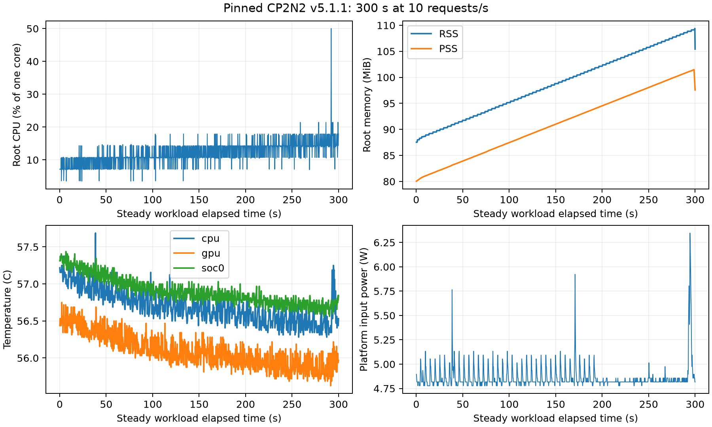

# CP2N2 v5.1.1 Embedded Resource Experiment

External 250 ms process-tree and Jetson telemetry; pinned upstream source unchanged. These are profiled experiments, separate from timing-only reproduction runs.

| Run/window | Exit | Seconds | Root CPU (% one core) | Root RSS max (MiB) | Tree PSS max (MiB) | Max temperature (C) | Platform power (W) |
| --- | ---: | ---: | ---: | ---: | ---: | ---: | ---: |
| core/command | 1 | 35.74 | 19.86 | 160.82 | 554.90 | 58.16 | 5.65 |
| e3-control/command | 0 | 1.90 | 134.46 | 89.12 | 74.58 | 57.50 | 5.41 |
| e3-provider/command | 0 | 5.58 | 23.54 | 69.53 | 267.65 | 57.91 | 5.72 |
| http/command | 0 | 3.01 | 71.18 | 85.62 | 123.44 | 57.50 | 5.50 |
| overhead/command | 0 | 3.88 | 112.88 | 126.89 | 113.95 | 57.66 | 5.42 |
| sustained-300s-10hz/command | 0 | 304.53 | 12.56 | 109.39 | 101.48 | 57.69 | 4.86 |
| sustained-300s-10hz/steady_workload | 0 | 300.00 | 12.10 | 109.39 | 101.48 | 57.69 | 4.86 |
| sustained-smoke/command | 0 | 6.66 | 34.58 | 86.13 | 78.35 | 57.44 | 5.00 |
| sustained-smoke/steady_workload | 0 | 2.00 | 8.69 | 86.13 | 78.35 | 57.28 | 4.87 |

## Interpretation

- Command windows include imports, evaluator work, output and plotting. Do not label these as control-plane-only footprint or energy.
- The steady_workload row excludes imports and initialization and uses the pinned upstream edge task factory. It is a sustained extension, not an original-paper measurement.
- Root CPU is the mean of sampled interval percentages; 100% is one logical CPU. Root RSS is the maximum observed resident memory, not a lifetime allocation delta.
- Tree PSS sums proportional memory when every observed workload process has a PSS sample; observers are excluded. Summed RSS double-counts shared pages and is retained only in JSON.
- PSS/USS are sampled at most once per second. Children shorter than the sampling interval may not be captured; the sample tree is not an exhaustive lifetime process census.
- CPU/GPU/SoC temperatures measure sensor temperatures, not heat flow. Power and thermal observations describe the platform and include unrelated system activity.
- Missing or long-gap power intervals are not extrapolated. Coverage and gap lists are retained in profile-results.json.
- A failed upstream command remains a failed condition even when telemetry is complete. The profiled full suite does not turn an aborted A6 matrix into a completed reproduction.
- A five-minute run at one rate does not establish one-hour stability, leak freedom, hard real-time behavior, or smartwatch suitability.

Verified 135 archived files before generating this report. Raw profiles and their per-run manifests are unchanged.

## Sustained outcome

- Duration: 300.0 s; configured rate: 10.0 requests/s.
- Completed: 3000; successful: 3000; missed planned releases: 0.
- Mean invocation latency: 13.639 ms; idempotent replays: 0; maintenance failures: 0.
- First/last-minute mean RSS: 90.20/107.18 MiB; mean PSS: 82.47/99.43 MiB.
- First/last-minute mean CPU: 9.08/14.99% of one core; invocation latency: 10.57/16.58 ms.
- Memory and CPU rose during this observed run. Successful completion is not evidence of a stable memory plateau or indefinite operation; do not hide growth behind the peak-memory number.

